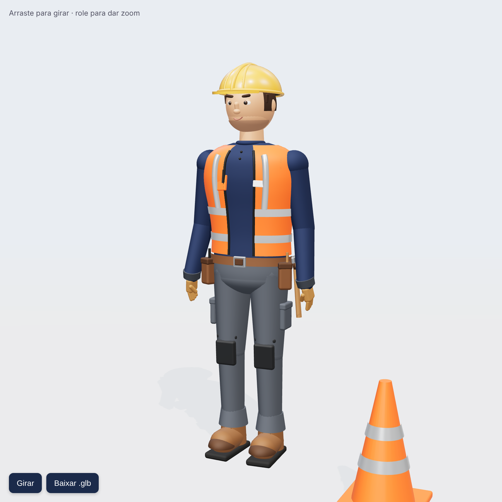

# Boneco Construtor 3D

Boneco masculino estilizado em 3D vestido de construtor, feito com [three.js](https://threejs.org/):

- Capacete amarelo com nervuras e pala
- Camisa manga longa azul escuro (`#1b2a4a`)
- Colete laranja de alta visibilidade com faixas refletivas, bolso e crachá
- Cinto de ferramentas com bolsas e martelo
- Calça de trabalho com bolsos cargo e joelheiras
- Luvas de couro e botinas com biqueira

## Como ver

Abra `index.html` no navegador (precisa de internet para carregar o three.js do CDN).

- Arraste para girar, role para dar zoom
- **Pausar rotação / Girar**: liga/desliga a rotação automática
- **Baixar .glb**: exporta o modelo para usar no Blender, Unity, etc.
